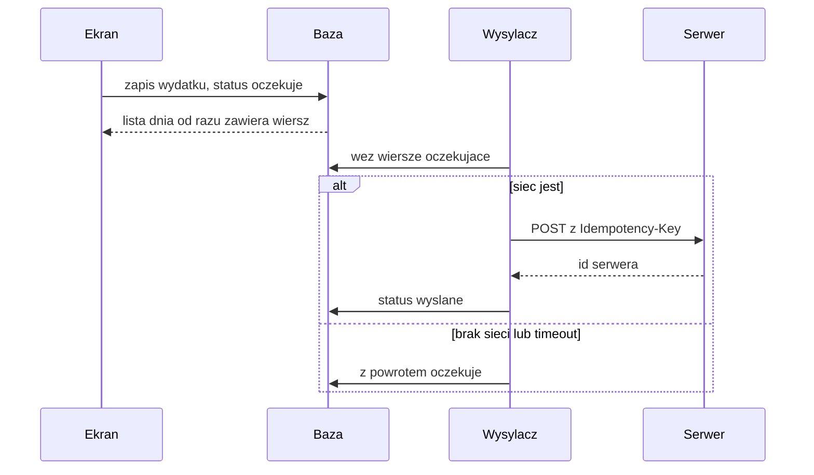

Ekran czyta wyłącznie z bazy w telefonie. Serwer, gdy jest osiągalny, uzupełnia tę bazę i odbiera kolejkę. Brak sieci nie blokuje ani podglądu ostatniego zestawienia, ani zapisu nowego wydatku.

Na Androidzie robi się to dwiema lokalnymi rolami w jednej bazie Room (SQLite) oraz jednym wysyłaczem w tle (WorkManager).

## Co leży w telefonie

**Pamięć podręczna** trzyma to, co serwer już oddał do pokazania: sumę miesiąca, słupki kategorii, listę dnia z wysłanych paragonów. Wiersz ma identyfikator serwera i czas pobrania. Kolejne udane pobranie nadpisuje te wiersze. Gdy sieci nie ma, ekran zostaje przy ostatniej kopii i pokazuje, z kiedy ona jest, na przykład „stan z 12 paź, 18:40”.

**Kolejka** trzyma to, co powstało w aplikacji i jeszcze nie zostało przyjęte przez serwer.

- Zdjęcie paragonu: skompresowany plik w katalogu aplikacji i wiersz ze statusem, datą zrobienia zdjęcia i lokalnym identyfikatorem (UUID).
- Wydatek ręczny: kategoria, kwota, opis, data, ten sam lokalny identyfikator.
- Poprawka pozycji, która już przyszła z serwera, a użytkownik zmienił jej kategorię bez sieci: osobne zlecenie aktualizacji podpięte pod identyfikator serwera.

Status wiersza w kolejce to jedno z czterech: `oczekuje`, `wysyłka`, `wysłane`, `błąd`. Plik zdjęcia kasuje się dopiero po `wysłane`.

Lista dnia składa oba źródła. Wysłany paragon wygląda jak dziś (sklep i suma). Pozycja z kolejki ma dodatkowo słowo statusu: „Czeka” albo „Błąd wysyłki”.

## Zapis i korekta

Zapis z formularza albo z aparatu nie woła REST. Wpisuje wiersz do Room ze statusem `oczekuje` i zamawia jednorazową pracę WorkManagera. Ekran od razu pokazuje nowy wiersz, bo obserwuje bazę (`Flow`), a nie odpowiedź HTTP.

Korekta otwiera ten sam formularz, który służy do tworzenia.

- Status `oczekuje` lub `błąd`: zapis zmienia lokalny wiersz. Na serwer pójdzie już poprawiona treść.
- Status `wysyłka`: wiersz jest w trakcie żądania. Poprawka zostaje w bazie z nowszym `updatedAt`. Wysyłacz po zakończeniu próby widzi, że wiersz się zmienił, i zostawia go jako `oczekuje`.
- Status `wysłane`: to już dane serwera. Zmiana kategorii tworzy nowe zlecenie w kolejce (aktualizacja), a podgląd pokazuje wersję lokalną do czasu potwierdzenia.

Zdjęcie, które jeszcze nie wróciło z rozpoznania, da się obejrzeć i usunąć z kolejki. Sklepu i pozycji wtedy nie ma, bo powstają na serwerze. Po powrocie sieci wysyłacz oddaje plik, serwer zwraca szkic paragonu, szkic wpada do pamięci podręcznej i dopiero wtedy otwiera się edycja kategorii.

## Wysyłka po powrocie sieci

WorkManager trzyma zlecenie także po zamknięciu aplikacji. Praca ma warunek „jest sieć” i powtarza się z rosnącą przerwą po błędzie. Ta sama praca startuje od razu, jeśli sieć jest w momencie zapisu.

Wysyłacz bierze wiersze `oczekuje` po kolei. Przed żądaniem ustawia `wysyłka`. Przy odpowiedzi 2xx zapisuje identyfikator serwera i status `wysłane`. Przy błędzie sieci wraca do `oczekuje`. Przy błędzie danych (na przykład odrzucone zdjęcie) ustawia `błąd` i treść komunikatu, którą widać przy wierszu. Token odświeża przed wysyłką, jeśli wygasł. Kolejki nie kasuje się tylko dlatego, że access token wygasł.

Serwer przyjmuje nagłówek `Idempotency-Key` równy lokalnemu UUID. Ponowienie po urwanym połączeniu nie tworzy drugiego paragonu ani drugiego wydatku.

Pobranie zestawienia działa odwrotnie. Przy otwarciu miesiąca i przy odświeżeniu aplikacja prosi serwer o ten miesiąc i podmienia pamięć podręczną. Nieudane pobranie zostawia poprzednią kopię.

Dla jednej osoby i jednego telefonu wystarczy zasada: do momentu `wysłane` prawda jest w telefonie, potem prawda jest na serwerze, a telefon trzyma kopię do czytania.